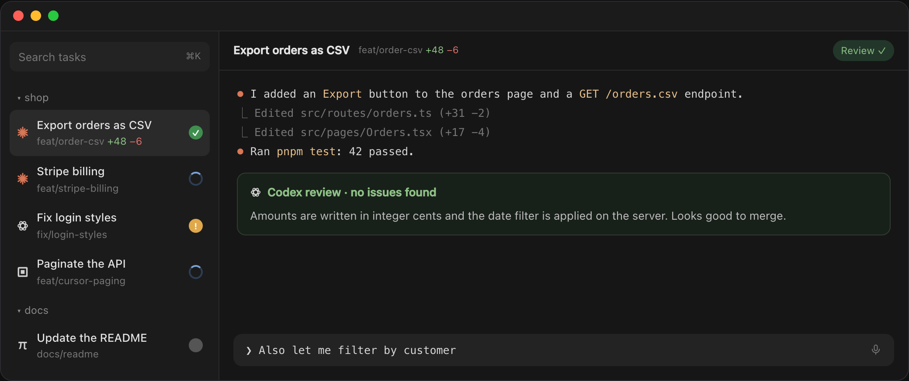

<p align="center"></p>

<h1 align="center">Duolo</h1>

<p align="center"><b>Your coding agents, working as a team.</b><br>Run Claude Code, Codex, OpenCode, pi and Grok in parallel on your own machine. One writes, another reviews,<br>and you steer from your desk, your phone or your voice.</p>

<p align="center">
  <a href="https://github.com/OtterMind/duolo/releases/latest"></a>
  <a href="https://github.com/OtterMind/duolo/actions/workflows/ci.yml"></a>
  <a href="LICENSE"></a>
</p>

<p align="center"><a href="https://duolo.io">Website</a> · <a href="https://github.com/OtterMind/duolo/releases/latest">Download for Mac</a> · <a href="#why-duolo">Why Duolo</a> · <a href="#how-duolo-compares">Compare</a> · <a href="#features">Features</a> · <a href="README.zh-CN.md">简体中文</a></p>

<p align="center"></p>

Duolo is a desktop app for running coding agents side by side. Every task gets its own git branch and worktree with the real agent CLI inside it: Claude Code, Codex, OpenCode, pi or Grok, in its own terminal or in a chat view. When the work is done, a second model reviews it read-only and you send the findings back with one click. The sidebar shows what each agent is doing and which ones are waiting for you. Agents run on your computer with your own accounts.

## Why Duolo

- **A second model checks every change.** Review is built in, not something you do by reading diffs: any agent reviews another's work read-only, in a throwaway copy with read-only tools, and its findings go back to the writer in one click. Hand a task to another agent to take over, or fork it so both versions run side by side, and switch back without losing either conversation.
- **Voice that knows your code.** Hold Fn and talk. Each recording carries the task's file names, code names and recent conversation, names said in pieces are put back together ("use state" → `useState`), and your own word list covers product and library names. Duolo can also tidy what you said into a clean instruction. It works the same on your phone.
- **Doesn't stop at a usage limit.** Sign in to several Claude or ChatGPT accounts. When one runs out, Duolo switches to the next and continues the same conversation.
- **A waiting task is really waiting for you.** Agents report their own state instead of Duolo guessing from the screen, and they start without trust or update prompts. One row per task tells you which ones need you; `⌥↓` jumps to the next.
- **Nothing gets lost.** Every task has its own branch and worktree. Closing a task commits its uncommitted changes to that branch first, and reopening it resumes the agent's own session.
- **Local and light.** A native Rust core in a Tauri shell, the agents' real CLIs, your own accounts. Messages between your phone and computer are end-to-end encrypted; the Duolo server only relays them.
- **Not only a window.** A `duolo` command line, a terminal UI for SSH, and scheduled automations that agents can set up for you. **14 languages** in the app, the command line, the terminal UI and the phone apps.

## How Duolo compares

[Orca](https://github.com/stablyai/orca) and [T3 Code](https://github.com/pingdotgg/t3code) are good open-source tools in the same space. All three run the agents' real CLIs with your own subscriptions, in parallel git worktrees, with a phone app. Where they differ:

| | Duolo | Orca | T3 Code |
|---|---|---|---|
| Second model reviews the change, findings sent back in one click | ✓ | You review the diff and comment on lines | You review the diff |
| Hand a task to another agent: take over, fork, or review | ✓ | An orchestrator agent splits work among workers | ✓ |
| Voice input that uses the task's code names, conversation and your word list | ✓ automatic | Dictation with a vocabulary you maintain | – |
| Phone and computer talk end-to-end encrypted | ✓ | Not stated | Not stated |
| Uncommitted work saved when a task closes | ✓ | Not stated | Not stated |
| Switches to the next account at a usage limit and keeps the conversation | ✓ | Usage tracking and account switching | – |
| Terminal and chat views of the same session | ✓ | ✓ | – |
| Scheduled automations | ✓ | ✓ | – |
| Terminal UI and command line | ✓ | Command line | – |
| Diff viewer, commit and pull request buttons | Not yet | ✓ | ✓ |
| Agents on remote machines | – | SSH hosts, remote server, cloud VMs | Local network, Tailscale, T3 Connect |
| Bots in Slack, GitHub and Linear | – | ✓ | – |
| Web client | – | – | ✓ |

Based on each project's README, website and changelog in November 2026; "–" and "not stated" mean we couldn't find it there. They move fast, so check their sites for the latest.

## Install

**Mac (Apple silicon or Intel):** download the dmg from [duolo.io](https://duolo.io) or the [latest release](https://github.com/OtterMind/duolo/releases/latest) and drag Duolo into Applications. It's signed and notarized; Settings → About tells you when a new version is out.

You also need git and at least one agent CLI: [Claude Code](https://docs.claude.com/en/docs/claude-code), [Codex](https://github.com/openai/codex), [OpenCode](https://opencode.ai), [pi](https://pi.dev) or [Grok](https://x.ai/cli). Duolo can install Claude Code and Codex for you and sign you in with your existing Claude or ChatGPT account.

<details>
<summary><b>Windows, Linux, or building from source</b></summary>

Install commands for the agents: Claude Code `curl -fsSL https://claude.ai/install.sh | bash`, Codex `curl -fsSL https://chatgpt.com/codex/install.sh | sh`, OpenCode `npm install -g opencode-ai`, pi `npm install -g @earendil-works/pi-coding-agent`, Grok `curl -fsSL https://x.ai/cli/install.sh | bash`. Building needs Rust 1.89+, Node 20+ and pnpm.

```sh
git clone https://github.com/OtterMind/duolo.git && cd duolo
cd app && pnpm install && pnpm tauri build
cargo install --path ../crates/duolo-cli        # optional: the duolo command
```

Bundles are written to `target/release/bundle/`:

| System | Bundle | Notes |
|---|---|---|
| macOS 12+ | `macos/Duolo.app` | Copy it to Applications |
| Windows 10 / 11 | `nsis/Duolo_*_x64-setup.exe`, `msi/*.msi` | The setup program installs for the current user, no administrator rights needed |
| Linux | `deb/*.deb`, `appimage/*.AppImage` | Needs WebKitGTK 4.1 (Ubuntu 22.04+, Debian 12+). To build: `libwebkit2gtk-4.1-dev libgtk-3-dev librsvg2-dev libxdo-dev libssl-dev` |

For development, `cd app && pnpm tauri dev` reloads the interface as you edit.

</details>

## Quick start

1. **Add a project** (`⌘O`): open a folder, clone from GitHub, or pick a repository Duolo found on your computer.
2. **Describe the task** (`⌘N`): type or say what you want and press Enter. Duolo creates a branch and a worktree and starts the agent; your first message becomes the task title, and AI names the branch.
3. **Review** (`⌘⇧R`): Codex reviews everything the task changed. Send its findings to the writer with one click, then merge the branch.

From the command line:

```sh
cd ~/code/shop
duolo                                              # open Duolo with this repository
duolo new "Export orders as CSV, filter by date"   # create a task without opening the app
duolo ls                                           # list tasks
duolo remove shop --yes                            # remove a project from Duolo (the folder stays)
duolo handoff 3 --to codex                         # let Codex take over task 3
duolo handoff 3 --to pi --fork "Use cursor paging" # Pi continues in a new task; task 3 keeps going
duolo tui                                          # terminal UI, handy over SSH
```

## Features

- **Parallel tasks.** Each task has its own branch and working directory (a git worktree under `~/.duolo/wt/`). Tasks don't affect each other or the checkout you are working in.
- **The real CLIs.** The main pane is Claude Code, Codex, OpenCode, pi or Grok itself, and you can switch between them per task. Duolo doesn't change how they behave.
- **Terminal or chat.** Claude Code, Codex and agents that speak ACP (OpenCode and Grok for now) can also run in chat mode: Duolo draws the conversation, tool calls and approval buttons itself, and streams the reply as it is written. Switch with the icons in the task's top bar; it continues the same session, and new tasks use your last choice.
- **Status at a glance.** One row per task: which model, and whether it is running, waiting for you, done or failed, plus the review result. Search, collapse projects, double-click to rename, right-click for more.
- **One writes, one reviews.** Pick Review under Hand off and Codex reads everything the task changed since it branched off, including uncommitted work and new files. It reviews in a temporary copy with only read-only tools: Claude can only read files, and Codex runs in its read-only sandbox with connectors and plugins turned off. Nothing it does can touch your work. One click sends the findings to Claude.
- **Hand off to another agent.** Click Hand off in the task's top bar (or right-click the task) and pick who and what: review the changes, take over in the same folder, or continue in a new task. A new task copies the current code, uncommitted changes included, to its own branch, and the original agent keeps working, so both run side by side. Either way the new agent gets the request and the recent conversation, plus an optional note from you, and looks at the current changes first. Switch back within a day and the earlier agent picks up its own conversation, told what happened while it was away. From the command line: `duolo handoff <task> --to codex [--fork | --review] [note]`; in the terminal UI, press `t`.
- **Side by side.** Drag tasks from the sidebar to the right (or `⌘`-click them) to watch up to six at once; drop on a pane's edge to put it beside, in the middle to replace it. The grid icon next to a project shows all its tasks side by side, waiting ones first. Drag the lines between panes to resize them (double-click one to even it out), drag a pane by its handle to move it, enlarge one with `⌘⇧↵`, and close one with its × (the task keeps running). `⌘\` goes back to one.
- **Built-in terminal.** Press `⌃`` (or the terminal icon in a task's top bar) to open terminals below the agent, in the task's own folder with your own shell; open several as tabs, drag the line above them to resize. If an agent exits (say after `Ctrl+C`), the bar at the bottom resumes its conversation or opens a terminal right there. Pasting a copied image or file (from Finder, a screenshot, or a web page) gives the agent its path, so Claude Code and Codex attach it. Click a link in any terminal to open it in your browser (dragging still selects text). Nothing opens outside Duolo ("Open in system terminal" is still in the ⋯ menu). A task doesn't need an AI either: pick Terminal when creating it and type a command such as `pnpm dev` or `cargo test`, or leave it empty for a plain shell. It runs in a shell in the task's own branch, and the terminal stays open afterwards so you can keep typing. From the command line: `duolo new --writer shell "cargo test"`.
- **Projects.** A project is a folder: one git repository, or a folder holding several. Add one (`⌘O`) by opening a folder, creating one, cloning from GitHub, or picking a repository found on your computer. You can also drop a folder on the window. New folders and clones go to `~/DuoloProjects`. Right-click a project (or its ⋯) to remove it from Duolo: its tasks are closed first with their changes saved on their branches, and the folder stays on your disk (`duolo remove <project> --yes` from the command line).
- **New tasks.** Click + next to a project (or press `⌘N`), type a request and press Enter. Everything else has a default you can change: repository, base branch, branch name (AI suggests one such as `feat/order-csv-export`), and who writes and who reviews.
- **Automations.** Click the alarm clock at the top of the sidebar to open the Automations page and have Duolo do things on a schedule (every day, weekdays, every week, every hour, or any cron). Each automation picks where it runs: a new task in a project each time, handed to the agent you picked; an existing task, continuing its conversation; or no project (tasks go in a separate Automations project). You can also just tell the agent in a task "every weekday at 9, …" and it sets one up with Duolo's `duolo` command (Claude knows about it for now). Run one now, pause it, and see what each recent run did or why it was skipped. Tasks it started carry a clock icon. Automations run while Duolo is open (a closed window counts); if Duolo was quit, a run missed within the last 12 hours runs once when you open it again, and if the previous run is still working the next one is skipped. From the command line: `duolo automation add "Fix the flakiest test" --cron "0 9 * * 1-5"` (`--here` sends it into the current task, `--no-project` keeps it out of your projects), plus `ls`, `run`, `pause`, `resume` and `rm`.
- **Accounts.** Duolo can install Claude Code and Codex for you and sign you in with your existing Claude or ChatGPT account; if it sees the Claude or ChatGPT desktop app, it offers to. You can sign in to several accounts (or use the ones already signed in to Orca); when one runs out of usage, Duolo switches to the next and continues the conversation.
- **Phone.** Settings → Phone shows a QR code; scan it with the Duolo app on your phone to check on tasks, answer agents and start new tasks while you're away. Messages between the phone and your computer are end-to-end encrypted, and the Duolo server ([server/](server/README.md)) only relays them.
- **Voice.** Hold `Fn` to talk (`Ctrl+Shift+Space` on Windows and Linux) and release to insert. Recognition knows the task's file and code names and puts names said in pieces back together ("use state" → `useState`); add your own words in Settings → Voice. Duolo can tidy up what you said into an instruction before inserting it, and you can switch back to your exact words.
- **Nothing lost on close.** Closing a task commits uncommitted changes to its branch before deleting the working directory. If something can't be saved, such as a nested repository, the task stays open and Duolo tells you why. Files ignored by git, such as `.env`, are deleted.
- **No startup questions.** Before starting an agent in a task, Duolo marks the folder as trusted in Claude Code (`~/.claude.json`) and Codex (`~/.codex/config.toml`, for the repository) and turns off their update prompts, so they don't stop to ask. Claude's entry is removed when the task closes.
- **Sessions resume.** Reopening a task continues that agent's own conversation, by session ID (`claude --resume <id>`, `codex resume <id>`).
- **Keeps working in the background** (macOS). `⌘W` hides the window and agents keep going; `⌘Q` stops them. On Windows and Linux closing the window quits, after asking if agents are running.
- **14 languages**, in the app, the command line and the terminal UI.

## Shortcuts

These are the macOS keys. On Windows and Linux `⌘` is `Ctrl` and `⌥` is `Alt`, and `⌘` plus a letter also takes `Shift` (`⌘N` is `Ctrl+Shift+N`), because `Ctrl` plus a letter belongs to the agent in the terminal. `Ctrl+C` copies when text is selected, and `Ctrl+V` pastes.

| Key | Action |
|---|---|
| `⌘N` | New task (press Enter with nothing typed for a blank one) |
| `⌘K` | Search tasks |
| `⌥↓` | Next task waiting for you |
| `⌘O` | Add a project |
| `⌘⇧R` | Review the current task |
| `⌃Tab` | Switch between the task's agents |
| `⌘1`–`⌘9`, `⌘⌥↑↓` | Switch tasks |
| `⌘\` | Put another task beside this one / back to one pane |
| `⌃`` | Show or hide the task's terminals |
| `⌘⌥←→` / `⌘⇧↵` | Side by side: go to the previous or next pane / enlarge the current one |
| `⌘⇧F` | Show the working directory in your file manager |
| `⌘⇧W` | Close the task |
| Hold `Fn` | Talk, release to insert. Tap Space while holding to lock, press Fn again to finish. You can also click the microphone. On Windows and Linux hold `Ctrl+Shift+Space`, or tap it to start and again to stop |
| `↵` / `⌘↵` / `Esc` while recording | Insert / insert and send / discard |
| `⇧↵` | New line in the agent's input |
| `⌘W` / `⌘Q` | Hide the window (macOS only) / quit |

Holding Fn needs the Accessibility permission once; Settings in the bottom left corner takes you there. If the 🌐 key opens the emoji picker or switches input sources, set "Press 🌐 key to" to "Do Nothing" in System Settings → Keyboard.

## Configuration

`~/.duolo/config.toml`. Every field is optional:

```toml
writer = "claude"          # default agent for writing code
reviewer = "codex"         # default agent for reviews

[agents.claude]            # changes the built-in settings; anything not listed stays as it is
command = "/opt/homebrew/bin/claude"
args = ["--model", "opus"]

server = "https://duolo.io"  # the Duolo server (speech recognition, phone pairing and relay); empty means none

[voice]
organize = false   # have the server tidy up filler words and self-corrections (off by default)
```

### Adding another agent

Every agent is a plugin: an `agent.toml` that says how to start, resume and review with it, in `~/.duolo/agents/<id>/`. See [docs/agents.md](docs/agents.md) (in Chinese). How Duolo keeps working when an agent updates (status reports, no startup dialogs, version checks, hooks) is in [docs/agent-compat.md](docs/agent-compat.md).

### Voice

Speech is recognized by the Duolo server (which passes it to Doubao streaming speech recognition), the same on macOS, Windows and Linux:

- Duolo records from the current input device, so a headset's microphone works when you wear one. The system asks for microphone access the first time.
- Each recording carries hints from the current task (your word list from Settings → Voice, recently touched files, code names from the conversation, the branch and project names) and the latest conversation, so mixed-language speech and code names come out right more often. Names that still come back in pieces are joined using the same hints ("export CSV" → `exportCsv`).
- The phone apps use the word list and the tidy-up setting from your computer.
- No sign-up: the first time, Duolo gets an anonymous identity from the server and keeps it in `~/.duolo/account.json`. The server limits use per identity per day.
- Your voice and these hints are sent to the Duolo server and the recognition service. If the server can't be reached, voice input is unavailable and Duolo says why.

## Architecture

```
app/ (React + xterm.js)
   │ Tauri commands / events / channels
duolo-app ─┐
duolo-tui ─┴▶ duolo-engine ─▶ duolo-pty   (PTY, output, state detection)
     │              ├───────▶ duolo-git   (worktrees, diffs)
     └▶ duolo-voice └───────▶ duolo-core  (model, config, storage)
```

Details are in [docs/architecture.md](docs/architecture.md), and the localization rules in [docs/i18n.md](docs/i18n.md) (both in Chinese).

## Limitations

- Duolo is early. macOS gets the most use; Windows and Linux are compiled and tested in CI but haven't been used end to end on real machines.
- There is no separate daemon: quitting stops all agents, and their sessions resume when you reopen a task.
- Agents report their own state; OpenCode doesn't yet, so its state is read from the screen and can lag.
- There is no diff viewer, merge or pull request support, system notifications or automatic updates yet. The iPhone app is in App Store review and the Android app is on its way to Google Play ([docs/mobile.md](docs/mobile.md)).
- On Linux the push-to-talk shortcut works on X11 only. On Wayland, click the microphone.

## Contributing

Issues and pull requests are welcome. Before submitting, run:

```sh
(cd app && pnpm build)          # type check and language files
cargo fmt --all && cargo clippy --workspace --all-targets -- -D warnings && cargo test --workspace
(cd server && pnpm check && pnpm test)   # if you changed the server; run docker compose up -d first
```

Conventions are in [AGENTS.md](AGENTS.md): all user-facing text must exist in all 14 languages, and the desktop app must work on all three systems.

## License

[MIT](LICENSE). Claude and Claude Code are trademarks of Anthropic, and Codex is a trademark of OpenAI. Duolo is an independent project and is not affiliated with either company, or with Orca or T3 Code.
